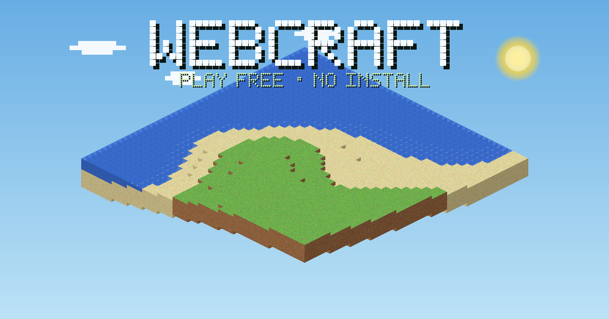

# WebCraft — Free Browser Voxel Sandbox

**Mine, craft, build and explore. No download. No login required to play.**

**[▶ Play now](https://aszx101123-debug.github.io/webcraft/play.html?lang=en)** · **[English game guide](https://aszx101123-debug.github.io/webcraft/en.html)** · [한국어 문서](README.ko.md)

[](https://github.com/aszx101123-debug/webcraft/actions/workflows/webcraft-check.yml)



WebCraft is a free, Minecraft-inspired voxel sandbox game that runs in desktop and mobile browsers. Start a single-player world or invite up to three friends, gather resources, craft your first tools and build a shelter before nightfall — or fly with unlimited blocks in creative mode.

## Choose your adventure

- **Survival:** mining, crafting, farming, cooking, hostile mobs, hearts, hunger and underwater air.
- **Creative:** unlimited blocks and flight for free building.
- **Co-op multiplayer:** up to 4 players with room codes and invite links, in survival or creative.
- **Explore:** 16 biomes, caves and ores, seeded terrain, weather and a day/night cycle.
- **Desktop and mobile:** keyboard/mouse and touch controls, plus character customization.
- **Keep your world:** browser autosaves and backup export/import from the Esc menu.

Both game modes work without an account. **Guests do not receive credits.** Daily credit rewards and badge exchanges require signing in and are checked by the server. Worlds are stored in the current browser; account sign-in does not provide cloud world storage.

## Dedicated public servers (v1.10.0 preparation)

A dedicated Node.js server and Korean/English lobby are prepared for a 100-player target, in survival and creative mode. Signed-in accounts choose an English nickname; guests receive server-assigned names such as `Guest1` and `Guest2`. The server persists names, guest numbers and shared worlds independently of a player's browser.

**Public hosting is not provisioned yet.** The existing live 4-player rooms remain available. See the [server deployment guide](server/README.md) and [Render Blueprint](render.yaml) for the recommended one-instance host, persistent disk, current baseline pricing and rollout steps.

## Play with friends

1. Open **[Multiplayer](https://aszx101123-debug.github.io/webcraft/multiplayer.html?lang=en)** and enter a display name.
2. Create a survival or creative room, then start the game. In the Esc menu, copy the **invite link** for friends; they can also enter the 12-character room code.
3. Keep the host's game tab open and active. Use **Reopen my last room** in the same browser to return to the saved room.

Players share terrain edits, doors, mobs, arrows, drops, crops, chests and furnaces. Chests and furnaces admit one user at a time. Crafting, equipment, hearts and hunger belong to each player. This is cooperative play without PvP, and multiplayer menus do not pause the world.

The host saves the room world locally; each participant saves their own inventory and survival stats in their browser. Room saves are separate from single-player saves. All modes allow guest play; multiplayer does not grant credits or create anonymous accounts.

The first multiplayer version uses Supabase Realtime as a public relay and the host browser as the shared simulation authority. Invite people you trust: this is not a dedicated anti-cheat server or a cloud world host. If the host leaves or their browser suspends the tab, guests wait for the host; no automatic host migration occurs. A live connection can resynchronize missed block changes. In-flight inventory actions should finish before closing the game. Initial synchronization supports up to 16,384 edited cells and a 1 MiB JSON snapshot; oversized worlds receive a readable join error.

## Quick start

1. Open **[WebCraft](https://aszx101123-debug.github.io/webcraft/play.html?lang=en)** in a browser.
2. Pick a world and choose survival or creative.
3. Mine a log, craft planks and make a crafting table — or start building with unlimited blocks.

| Control | Action |
| --- | --- |
| `W A S D` | Move |
| `Space` | Jump / swim up / fly up |
| `Shift` | Sneak / fly down |
| `Ctrl` + `W` | Sprint |
| Left click / right click | Mine or attack / place or use |
| `E` | Inventory and crafting |
| `1`–`9` / mouse wheel | Select hotbar slot |
| `Esc` | Pause, settings and world backups |
| `F5` | Change camera view |

On mobile, use the joystick to move, drag to look around, tap to use/place and hold to mine. Hold the jump button to swim up.

## What's new in v1.9.0

- Four-player cooperative survival and creative rooms, without a login.
- Remote avatars, shared blocks and doors, host-controlled mobs and shared drops.
- Shared farming and storage, with exclusive container access and deduplicated action retries.
- Late-join snapshots, missed-change recovery and separate room saves.
- Korean and English room creation and invitation screens.

The earlier underwater indicators, cactus model, pixel hearts/hunger and account-only credit rewards remain available.

## Feedback and sharing

Found a bug? [Open an issue](https://github.com/aszx101123-debug/webcraft/issues) with your browser/device, what happened and the steps to reproduce it. Feature suggestions and builds are welcome too.

If you enjoy WebCraft, a GitHub star and a link shared with friends help others discover it. The [English introduction](https://aszx101123-debug.github.io/webcraft/en.html) has a readable overview and a direct play link. [Promotion copy](PROMOTION.md) is available in English and Korean.

## Run locally

The game uses JavaScript, Three.js and WebGL. The Three.js library is included in the repository. From a local checkout:

```sh
python -m http.server 8000
```

Open `http://localhost:8000/play.html?lang=en`. No build step is required for the static game. Multiplayer and account credit features use the configured Supabase backend. Single-player still works without the auth SDK.

```sh
npm ci --prefix server
npm test
```

Tests cover terrain, game-loop behavior, inventory, crafting, saves, collisions, water detection, underwater HUD, guest/account credit controls, multiplayer room admission, synchronization, shared drops and container transactions. See [README.ko.md](README.ko.md) for the full module layout and technical notes.

## Credits

WebCraft is an independent, unofficial fan project inspired by Minecraft. It is not affiliated with Mojang Studios or Microsoft.

The classic texture pack includes work by XSSheep (Pixel Perfection) and VoxeLibre contributors under CC BY-SA 3.0. See [texture attribution](img/classic/README.txt) and the [license](img/classic/LICENSE-CC-BY-SA-3.0.txt).
